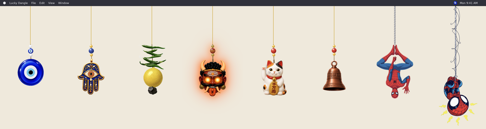

<div align="center">

# 🧿 Lucky Dangle

**Lucky charms that dangle from the top of your Mac screen.**
Grab them, fling them, ring them, and watch them swing back.




</div>

---

## What it is

Lucky Dangle is a tiny Mac app with no Dock icon. It lives in your menu bar, and a charm hangs from the top
edge of your screen on a string. The charm is a real hanging weight: it swings, stretches the string, bounces
back, and settles. Click it, drag it, or just brush your cursor past it.

The window ignores the mouse everywhere except over the charm, so it never gets in the way of the apps behind it.

## 🪬 The charms

| # | Charm | What it does | String |
| --- | --- | --- | --- |
| 1 | **Evil eye** | Glossy blue glass | Gold |
| 2 | **Hamsa** | **Blinks** when you click it, and keeps blinking while you drag it | Gold |
| 3 | **Chili and lemon** | A string of green chilies over a lemon | Gold |
| 4 | **Oni mask** | **Glows** while you hold it: eyes, horns, tusks, tongue and crown gems light up with an orange aura | Gold |
| 5 | **Lucky cat** | Its raised paw swings **front and back**, towards you and away | Gold |
| 6 | **Bell** | **Rings** when you click or shake it, with a real bell sound made in code | Gold |
| 7 | **Spider-Man (cartoon)** | Hangs upside down on a pale twisted web cord | Twisted cord |
| 8 | **Spidey (chibi)** | His spidey-sense marks pulse, and he hangs from a long, curly, hand-inked web | Inked web |

## How it works

- **One weight on an elastic cord.** Gravity pulls the charm down, the cord only pulls back when it's
  stretched (it goes limp when slack), and air drag slowly settles it. Each frame runs eight small physics
  steps so it stays smooth and stable.
- **Strings are drawn in code.** Every string style is drawn from the same curve, so the gold string, the
  twisted cord and the looping web all follow the cord's motion.
- **Charms are layered pictures.** A charm is a transparent PNG plus optional layers on top: the cat's arm,
  the hamsa's closed eye, the oni's glow. Layers can loop on their own or be driven by a reaction.
- **No audio files.** The bell is built from the overtones of a struck bell using the Web Audio API.
- **Sharp on Retina.** The string canvas is drawn at your screen's full pixel density.

## Run it from source

You need a Mac and [Node.js](https://nodejs.org/) 20 or newer.

```bash
npm install
npm start
```

## Build the Mac app

This makes a normal `LuckyDangle.app` you can open by double-clicking, with no terminal needed afterwards.

```bash
npm run package
```

The app appears in `dist/LuckyDangle-darwin-arm64` (or `-x64` on an Intel Mac). Copy it somewhere and open it:

```bash
ditto dist/LuckyDangle-darwin-arm64/LuckyDangle.app ~/Applications/LuckyDangle.app
open ~/Applications/LuckyDangle.app
```

Quit any running copy (menu bar icon → **Quit Lucky Dangle**) before replacing the app.

> **Tip:** if the menu bar is crowded, macOS can hide the eye icon. Hold **Command** and drag other icons off
> the bar to make room.

## ➕ Add your own charm

1. Make a transparent PNG with the charm at the bottom and the point where the string attaches at the
   **top centre** of the picture. Drop it in `src/charms/`.
2. Add a line to the list in `src/charms.js`:

   ```js
   { name: "My charm", src: "charms/my-charm.png", height: 240 },
   ```

3. Add the same name, in the same position, to the `CHARM_NAMES` list in `main.js` so it shows up in the menu bar menu.

Optional extras on a charm:

| Option | Does |
| --- | --- |
| `react: "bell"` / `"blink"` / `"glow"` | Reacts when clicked or dragged |
| `rope: "toon"` / `"web"` / `"silk"` / `"comic"` | Picks a different string style (the default is gold) |
| `ropeLength: 320` | Makes the string longer |
| `layers: [...]` | Extra pictures on top. Give one a `name` to drive it from a reaction, or `keyframes` to loop it |

The feel of the swing (gravity, bounce, drag) is a short list of numbers at the top of `src/physics.js`.

## Notes

- Built and tested on a Mac with an Apple Silicon chip. Electron is pinned to version 33 and the packager to
  version 18, which work with Node 20.
- **Artwork:** the charm pictures, including the Spider-Man ones, come from third-party images and are not
  covered by any licence here. They are for personal use. Swap in your own pictures before sharing this project.
